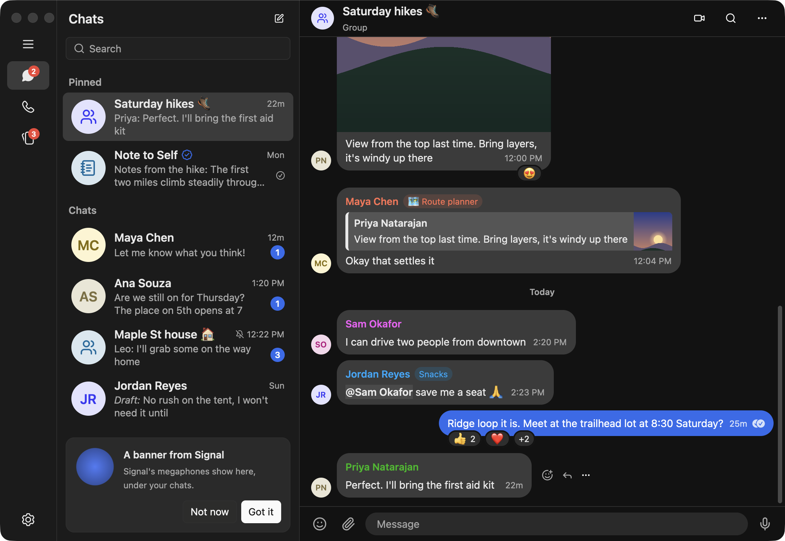

# Signal GPUI

A native Signal Desktop client built on [GPUI](https://gpui-kit.com) (via `gpui-kit`), linked to your phone as a secondary device like Signal Desktop.



## Workspace

| Crate | Role |
| --- | --- |
| `crates/app` (`signal-gpui`) | GPUI UI: link screen, conversation list, timeline, composer, emoji picker |
| `crates/backend` | Signal networking on a dedicated Tokio thread, via [presage](https://github.com/whisperfish/presage) → libsignal-service-rs → [libsignal](https://github.com/signalapp/libsignal) v0.99. The UI talks to it with `Command`s / `Event`s |
| `crates/store` | Encrypted app database (SQLCipher through sqlx): conversations, messages, FTS5 search, emoji usage, settings |
| `crates/emoji` | Emoji table and FST search / type-ahead, generated at build time from vendored emojibase data |

## Beyond Signal Desktop

Things this client does that Signal Desktop doesn't:

- **Less memory.** In one Activity Monitor spot check (Memory column, same account, both apps open), Signal GPUI used 121 MB. Signal Desktop's six processes (main, renderer and four helpers) used 1,038 MB, so that's about 12%. Adding the 11 MB AutoFill process macOS starts for our text fields makes it 132 MB, about 13%. Signal Desktop runs on Electron; this is one native process.
- **Lossless image optimization.** Images you send are shrunk without changing a pixel: PNG with [oxipng](https://github.com/shssoichiro/oxipng) at its maximum preset, JPEG with mozjpeg's lossless transcode (optimized Huffman tables, searched progressive scans). Signal Desktop re-encodes images lossily instead. Settings → Images picks Maximum (default), Fast or Off. Every level removes metadata such as location while keeping the colour profile and rotation.
- **Reply from a notification.** New-message notifications have a reply field and Mark as Read; Signal Desktop's notifications only open the chat. They follow Desktop otherwise: grouped per chat, none for the chat you're looking at, none for muted chats unless you're mentioned, and taken down once the chat is read (here or on another device). Settings → Notifications picks name and message, name only, no name or content, or off. The Dock shows your unread count.
- **Any pasted image.** TIFF and BMP (which macOS often puts on the clipboard) are converted to PNG losslessly before sending.
- **Emoji search with typo tolerance.** An FST index over names, keywords and shortcodes answers in microseconds, matches words in any order, tolerates one typo, and ranks by your own usage.
- **Bounded image memory.** Decoded photos are kept in a per-conversation cache with a budget, rather than for the life of the app.
- **Developer conveniences.** An offline demo mode (`SIGNAL_GPUI_DEMO`), separate profiles (`SIGNAL_GPUI_DATA_DIR`), opening without stealing focus (`SIGNAL_GPUI_BACKGROUND`), and stable code signing for development builds (`scripts/setup-dev-signing.sh`).

## Storage and encryption

Like Signal Desktop, a random 256-bit SQLCipher key is generated on first run and kept in the OS credential store: the macOS Keychain (service `signal-gpui`). Elsewhere it goes in a `0600` key file. Two SQLCipher databases share that raw key (`PRAGMA key = "x'…'"`):

- `signal.db`: presage's protocol state (identity, sessions, pre-keys, contacts, groups)
- `app.db`: the UI projection (conversations, messages, reactions, drafts, FTS index)

Downloaded attachments (`attachments/`) and profile/group photos (`avatars/`) are stored decrypted on disk for now.

Display names come from the account's Storage Service contact records (nickname, then address-book name, then profile name), falling back to contact sync and fetched profiles (using profile keys from shared groups for people who aren't contacts). Messages that arrived before a sender's name was known are renamed once it is. Pins, archived and muted chats come from there too, and re-sync when your phone reports a storage change. Right-click a chat to pin or unpin it (up to 4). The change is written back to Storage Service, editing only the pinned list and keeping any fields this client doesn't understand, and then your other devices are told to fetch it. Archiving and muting are read-only here for now.

## Sending images and files

Attach with the paperclip, paste (⌘V, including images macOS puts on the clipboard as TIFF), or drop files on the composer; typed text becomes the caption. Files that aren't images (PDFs, documents, audio, archives, up to Signal's 100 MB) are sent as they are, each as a message of its own as in Desktop; the text goes with the images, or with the first file when there are none. Clicking a file you sent or downloaded opens it in its app.

Images are optimized losslessly before upload (at the level chosen in Settings → Images), in the outbound queue so messages keep their order:

- PNG: [oxipng](https://github.com/shssoichiro/oxipng) at its maximum preset (`-o max`), keeping only chunks that affect rendering (colour profile, gamma, physical size).
- JPEG: mozjpeg's lossless transcode (what `jpegtran -optimize -progressive` does): the DCT coefficients are copied, so pixels are identical; Huffman tables and progressive scans are re-optimized. The ICC profile and EXIF orientation are kept; all other metadata, including GPS, is dropped.
- WebP: the EXIF and XMP chunks (which can hold location) are removed; the image itself is unchanged.
- TIFF and BMP become PNG first (losslessly); GIF is sent as it is.

## Stickers and GIFs

From the composer, the emoji button opens Signal Desktop's picker with Emoji, Stickers and GIFs tabs (reactions stay emoji-only).

- Stickers: the packs installed in Signal on your phone (synced as you install them), with "Recently used" first. Search goes through emoji search and shows stickers whose emoji matches, as Desktop does. Stickers show without a bubble, up to 200pt.
- GIFs: trending until you type, then Giphy search (rated pg-13), through Signal's content proxy so Giphy doesn't see your IP address. Sent GIFs are MP4s flagged as GIFs, like Desktop's. GIF search needs your own Giphy API key, free at developers.giphy.com. Paste it in the GIFs tab or set `GIPHY_API_KEY`. Signal Desktop's built-in key belongs to Signal, so this client doesn't use it.
- GIFs you send and receive loop silently in the chat. They're decoded with the `ffmpeg` command-line tool (`brew install ffmpeg`), scaled to display size, at most 30 fps and 15 seconds. Decoded loops share a 256 MB budget; ones still on screen are kept even past it.

## Link previews

Following Signal Desktop's rules:

- Only https links on a plain domain are previewed; credentials in the URL, IP addresses, mixed-script domains, odd path characters and test or `.onion` domains are not. A received preview shows only if its link is in the message.
- Big, non-square images span the bubble; others sit beside the title as a 72pt thumbnail. A reply shows the quoted message's photo or preview image.
- While you type, the first eligible link is fetched directly from the site (as Desktop does): at most 1 MB of HTML and a 1 MB image, every redirect re-checked, TLS checked against the system trust store. The image gets the same lossless treatment as other images you send. Dismissed previews stay dismissed for that draft. Turning off "Generate link previews" in Signal on your phone turns it off here.

## Debug log

Logs go to stderr and to daily files in `logs/` in the data directory (the last three days are kept; panics are logged too). Help → Debug Log (or Settings → Debug log) works like Signal Desktop's: system and account info, then the logs, redacted with Desktop's rules (phone numbers, account and group ids, call-link and attachment keys, card-like numbers, and our own and your home directory's paths). Save writes it to a file; Submit uploads it, gzipped, to debuglogs.org (Signal's debug log service, as Desktop does) and shows a link to share.

## Memory

- The timeline and chat list are virtualized (gpui `list`): only visible rows are laid out and drawn.
- A conversation loads 60 messages, then 60 more as you scroll toward the top; loaded pages stay until you switch conversations, when the view and its messages are dropped.
- Decoded photos go through a per-conversation LRU cache (256 MB of decoded pixels), freed on switching; gpui's default would keep every decoded image for the life of the app.

## Emoji search

`build.rs` turns emojibase's labels, CLDR keywords and iamcal/GitHub shortcodes into a static table plus an [`fst`](https://docs.rs/fst) map from normalized term to a posting list. A query is:

1. a prefix range scan over the whole query (`slightly_sm` → `slightly_smiling_face`);
2. per-word prefix scans, intersected, so word order doesn't matter (`face smiling`);
3. if results run short, a Levenshtein-1 automaton plus adjacent-swap prefixes for typos (`smlie`, `pizzza`).

Results are ranked by match kind (shortcode > name > word > keyword), exactness and completion length, plus a boost from your own usage (frequency and recency). Emoji newer than the system font supports are filtered out. Release-build timings: 2–45 µs per query (`cargo bench -p signal-emoji`).

In the composer:

- `:` plus two or more characters opens the type-ahead. ↑/↓ move, Enter or Tab inserts, Esc dismisses.
- A complete `:shortcode:` is replaced as you type the closing colon.
- Messages made only of emoji (up to five) render as jumbomoji.

## Chats

The ⋯ menu in a chat's header (and right-clicking a chat in the list) works like Signal Desktop's:

- **Disappearing messages:** Off, 4 weeks down to 30 seconds, or a custom time. In 1:1 chats every message carries the timer and its version, and a message only changes the timer when its version is at least ours, as in Desktop. Your messages count down from when they're sent, others' from when you read them. A group's timer is part of the group, so changing it goes through Signal's group server, for whoever may edit the group's details.
- **Mute notifications** (1 hour, 8 hours, 1 day, 1 week, always), **Mark as unread**, **Pin chat**, **Archive** and **Block** are saved to Storage Service, so your phone and other devices follow. Only the one field changes; everything else in the record, including fields this client doesn't know, is kept. Nothing from a blocked person or group is shown, and a blocked chat offers Unblock in place of the composer.
- **Group settings:** rename the group and edit its description (if you may edit its details), see its members and admins, and leave it. Group changes go to Signal's group server (`PATCH /v1/groups/`, which libsignal-service-rs has no call for), then to the members. Changes anyone makes show as notices ("Alice changed the group name to …", "Bob left the group."). Blocking a group also leaves it, as in Desktop.
- **Member labels:** Signal's per-group labels show after each sender's name. Set yours in Group settings (up to 24 characters, with an optional emoji) when the group allows it.
- **New group** (the pencil at the top of the chat list): name it and pick members. Members whose profile key is known join at once; the rest are invited, as in Desktop.
- **All media:** a chat's photos, documents and links.
- **Select messages**, then forward (up to 30 messages, to up to 5 chats) or delete them.
- **Safety number** (Chat settings in a 1:1 chat): the 60 digits and QR code, computed as Signal does (libsignal's fingerprint over both ACIs and identity keys), to compare with the other person's device. **Mark as verified** is tied to their current identity key, so it lapses when their key changes, and it's synced with your other devices both ways (Signal's Verified sync message).
- **Search in chat** (⌘⇧F, or the magnifying glass in the header) works as in Desktop: the sidebar's search box shows the chat's avatar and searches only that chat, listing each match under its sender; picking one jumps to it. The ✕ beside the avatar, Escape, or Backspace in the empty box goes back to searching everything. Results from the main search jump too.
- **Chat details:** click the avatar or name in a chat's header.

## Messages

Hover a message for React, Download (saves its attachments), Reply and a ⋯ menu; right-click opens the same menu:

- **Forward**, **Select**, **Copy text**, **Info** (when it was sent and received, and its status), **Delete**, and **Retry Send** for a failed message (sent again with its original timestamp).
- **Edit** your text messages for 24 hours (any time in Note to Self), up to 10 times. ↑ in an empty composer edits your last message.
- **Pin** for 24 hours, 7 days, 30 days or forever; a chat keeps three pins, and a fourth replaces the oldest. Pins show in a bar under the header; clicking it goes to each in turn. In groups, pinning follows who may edit the group's details.
- **@mentions** in groups: type @ for a list of members. A mention is sent as Signal's placeholder and range, and mentions show highlighted.
- **Formatting**: received bold, italic, strikethrough, monospace and spoilers show as Desktop shows them; a spoiler is a block until you click it, and stays `■■■■` in the chat list, notifications and quotes. To send formatting, write `*bold*`, `_italic_`, `~strikethrough~`, `` `monospace` `` or `||spoiler||`, or select text and use Desktop's shortcuts (⌘B, ⌘I, ⌘⇧X, ⌘E, ⌘⇧B), which add those markers. They're sent as Signal's formatting, so other clients show the styles, not the markers. Desktop styles the text in its composer as you type; the composer here can't show styles, which is why it uses markers. A marker only counts at a word's edge, so `snake_case` stays as typed, and so does formatting that starts mid-word.

Timer changes and pins leave a notice in the timeline ("Alice pinned a message", with Go to message).

## Deleting

Deleting works as in Signal Desktop:

- **Delete for me** removes a message here and on your other devices. Right-click a chat → Delete removes the whole chat the same way. Signal Desktop has no local-only delete anymore, so neither does this.
- **Delete for everyone** is offered only for your own messages that actually went out, within 24 hours of sending, and never in Note to Self. Deletes from others are honored only from the message's author and within 48 hours (a day, plus a day for slow delivery).
- When a chat is deleted on another device, only messages up to the newest one that device had are removed. The chat itself goes only if nothing newer has arrived here.

## Calls

Voice and video calls, 1:1 and in groups, work as in Signal Desktop, through RingRTC (Signal's calling library, which Desktop also uses), Signal's TURN relays and, for groups, Signal's calling server:

- **Call buttons** in a chat's header open Desktop's lobby: your camera's preview (or "Your camera is off"), camera and microphone toggles, and Start. A 1:1 lobby says "Signal will ring" them; a group's says who's already in the call ("Maya is in this call", with Join) or who will be rung (groups of up to 16; bigger groups are only notified).
- **The call screen** shows their video (or their photo, name and "Ringing…", "Connecting…" or how long the call has run), your camera in the corner, and camera, microphone, Present and End controls. A group call shows everyone in a grid, named, with their video or photo and a muted mark; whoever presents fills the screen. Minimize shrinks it to a small window in the corner; clicking that brings it back.
- **Presenting** shares a screen or a window (picked from a list) in place of your camera, which comes back after. macOS asks for screen recording access the first time.
- **Incoming calls** show Desktop's bar across the top (Decline, Answer, and for video calls Answer without video), play Desktop's ringtone, and post a notification. A group ring says who's calling.
- **Call history:** each 1:1 call leaves a notice in the chat ("Missed voice call", "Outgoing video call", …) with Call back or Call again, synced with your other devices' call lists. Starting a group call tells the group ("Alice started a group call", with Join).
- Calls with someone you have no chat with go entirely through Signal's relays, as in Desktop, so they don't learn your IP address.

Settings → Calls picks the microphone, speaker and camera. macOS asks for camera and microphone access the first time (this needs the app bundle; see Running). Call links aren't done yet.

## Message history when linking

Like Signal Desktop's "link and sync", the link QR code asks your phone to send your message history (`capabilities=backup5`). After linking, the app waits for the phone to upload it (up to an hour), downloads it, checks and decrypts it with the one-time key from linking, and imports your chats: names, archived, muted, pinned and unread state, timers, and messages with their quotes, reactions, mentions, pins and read state. Messages that have already disappeared are skipped, and an edited message keeps its edit history's timestamps. Attachments still on Signal's transit tier (where the phone puts them for the transfer, for a limited time) download from there: photos and GIFs right after the import, other files when you open them. Sticker packs installed on the phone are installed here too. The chat list shows how it's going, and if the app quits partway it carries on next time.

## Finding people

Search covers your chats, then (like Signal Desktop) everyone in your Signal contacts and every group you're in, even without a conversation yet. These come from the Storage Service, your phone's contact sync and your groups; hidden and blocked contacts are left out. A search that looks like a username (`name.12`) or phone number offers "Find … on Signal", which looks it up (usernames through Signal's username lookup, numbers through contact discovery, reading numbers without a country code as being in your own country) and starts the chat.

## Running

Building needs `cmake` (for BoringSSL, used by Signal's contact discovery) and `protoc` (for RingRTC, Signal's calling library), and playing GIFs needs `ffmpeg`: `brew install cmake protobuf ffmpeg`. The first build downloads Signal's prebuilt WebRTC for calls (about 28 MB) into `target/webrtc`.

```sh
cargo run --release                     # real account: shows a QR code to scan from Signal on your phone
SIGNAL_GPUI_DATA_DIR=/tmp/sg cargo run  # separate profile; key kept in a file, not the Keychain
SIGNAL_GPUI_DEMO=1 SIGNAL_GPUI_DATA_DIR=/tmp/sg-demo cargo run   # demo data; never connects to Signal (link previews and, with a Giphy key, GIFs still use the network)
SIGNAL_GPUI_BACKGROUND=1 …              # open without taking keyboard focus
```

On macOS the database key lives in the login keychain, and Keychain access depends on the app's code signature. Builds without an Apple team ID ask for your password after every rebuild. A free "Apple Development" certificate from Xcode stops that; `scripts/bundle.sh`, which the cargo runner uses, signs with it automatically. [docs/signing.md](docs/signing.md) explains why and has the steps.

macOS only shows notifications from an app bundle. `cargo run` runs the app from `target/<profile>/Signal GPUI.app`, which the runner makes; for a build you start yourself, `scripts/bundle.sh` makes the bundle and prints the executable to run. A bare binary works the same, without notifications.

Shortcuts: ⌘, settings, ⌘F search, ⌥↑/⌥↓ (or ⌃Tab / ⌃⇧Tab) switch chats, Enter send, ⇧Enter newline.

## Tests

```sh
cargo test --workspace   # store, mapping, emoji, and headless GPUI composer tests
cargo bench -p signal-emoji
```

## Not yet implemented

Call links, stories, adding and removing group members, and most settings. New identity keys are trusted automatically: a key change shows Desktop's "Your safety number with … has changed" notice (in the 1:1 chat and shared groups) and clears a verification, but sending isn't held for confirmation. Attachments in transferred history that are only in the backup (media) tier, which needs a backup subscription, aren't downloaded. See `todo.md` for more.

## License

AGPL-3.0-only (see `LICENSE`), as required by libsignal, libsignal-service-rs and presage. Third-party notices, including the emojibase (MIT), Lucide (ISC) and mozjpeg (IJG) attributions, are in `NOTICE`. This is an unofficial client, not affiliated with Signal.
